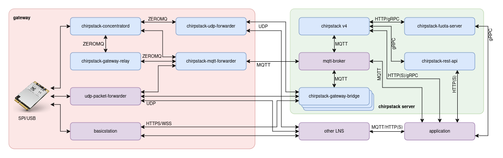

# ChirpStack Gateway Mesh service for Docker

This is an **unofficial** build of the ChirpStack Gateway Mesh service meant to be deployed using docker. The binaries included with this image are built from the chirpstack-gateway-mesh fork at https://github.com/xoseperez/chirpstack-gateway-mesh and may have small differences with the original binaries (check the repo for more info).

Please refer to the original sources of the project whenever possible, contribute and donate to Orne for his great work: https://github.com/chirpstack/chirpstack-gateway-mesh

ChirpStack Gateway Mesh is an open-source LoRa(WAN) gateway mesh implementation, part of the ChirpStack project. It requires other components in order to build a viable LoRaWAN solution: chirpstack-concentratord and, for the border gateway, chirpstack-mqtt-forwarder.



## Tags

Each release of the fork (`v<upstream version>-r<n>`) is published as:

Tag | Points to
--- | ---
`4.1.4-r1` | that release (never changes)
`4.1.4`, `4.1`, `4`, `latest` | the newest release

Every tag is a multi-arch image for `linux/amd64`, `linux/arm64` and `linux/arm/v7`, and Docker picks the right one. The per-architecture tags (`amd64-latest`, `aarch64-latest`, `armv7hf-latest`) are no longer published.

## Chirpstack Gateway Mesh service variables

These variables you can set them under the `environment` tag in the `docker-compose.yml` file or using an environment file (with the `env_file` tag).

Variable Name | Value | Description | Default
--- | --- | --- | ---
**`LOGGING_LEVEL`** | `STRING` | One of `TRACE`, `DEBUG`, `INFO`, `WARN` or `ERROR` | `INFO`
**`RELAY_BORDER`** | `true` or `false` | Set to `true` if this is a border gateway | `false`
**`RELAY_ROOT_KEY`** | `STRING` | Mesh root key, 32 hex characters: the signing and encryption keys are derived from it. Must be the same on every gateway of the mesh (see below) | all zeros (insecure)
**`RELAY_SIGNING_KEY`** | `STRING` | Deprecated: if set, signs mesh packets instead of the key derived from `RELAY_ROOT_KEY` (see below) | all zeros (not set)
**`RELAY_ID`** | `STRING` | Relay ID, 8 hex characters, instead of the one derived from the gateway ID | *empty*
**`RELAY_MAX_HOP_COUNT`** | `INT` | Maximum number of hops a relayed payload will pass | `1`
**`RELAY_IGNORE_DIRECT`** | `true` or `false` | Border gateways only: set to `true` to ignore direct uplinks, so only relayed ones are processed (useful for testing) | `false`
**`RELAY_HEARTBEAT_INTERVAL`** | `STRING` | Relay gateways only: how often to send a heartbeat, as a duration such as `5m` | `5m`
**`RELAY_REGION_DEVICES`** | `STRING` | Region of the end-devices, which sets the channel and data-rate mappings: `as923`, `as923_2`, `as923_3`, `as923_4`, `au915`, `eu868`, `in865`, `ism2400`, `kr920`, `ru864` or `us915` | `eu868`
**`RELAY_REGION_RELAY`** | `STRING` | Band of the link between gateways, which sets the default frequencies and TX power: `eu868`, `us915` or `ism2400` | `eu868`
**`RELAY_FREQUENCIES`** | `STRING` | Comma-separated frequencies (Hz) for the link between gateways. Required for bands other than the three above | from `RELAY_REGION_RELAY`
**`RELAY_TX_POWER`** | `INT` | TX power (EIRP, dBm) for the link between gateways | `10` for `ism2400`, `16` otherwise
**`RELAY_MODULATION`** | `STRING` | Modulation for the link between gateways: `LORA` or `FSK` | `LORA`
**`RELAY_SF`** | `INT` | Spreading factor (LORA only) | `7`
**`RELAY_BANDWIDTH`** | `INT` | Bandwidth in Hz (LORA only) | `125000`
**`RELAY_CODERATE`** | `STRING` | Code-rate (LORA only) | `4/5`
**`RELAY_FSK_BITRATE`** | `INT` | Bitrate (FSK only) | `0`
**`RELAY_SOCKET_DEVICES`** | `STRING` | Socket name of the concentratord service talking to end-devices | `concentratord`
**`RELAY_SOCKET_RELAY`** | `STRING` | Socket name of the concentratord service talking to other gateways (can be the same as `RELAY_SOCKET_DEVICES`) | `concentratord`
**`RELAY_SOCKET_FORWARDER`** | `STRING` | Border gateways only: socket name offered to the chirpstack-mqtt-forwarder service | `forwarder`

The modulation settings must match what the concentrators on the link between gateways listen to. For example, the 2.4 GHz concentrators listen at SF12 and 812 kHz on the three default `ism2400` frequencies.

### Keys

Every gateway of a mesh must use the same keys, so changing them means changing all gateways at the same time.

- For a new mesh, set the same `RELAY_ROOT_KEY` on every gateway, for example one made with `openssl rand -hex 16`.
- A mesh that uses `RELAY_SIGNING_KEY` keeps working: that key still signs the mesh packets. Event and command payloads are always encrypted with a key derived from `RELAY_ROOT_KEY`, though, so without one anyone can decrypt them. To move to `RELAY_ROOT_KEY`, set it on every gateway and remove `RELAY_SIGNING_KEY`, all at once.

The log warns about either key situation at every start.

### Older names

`RELAY_REGION` still works as a name for `RELAY_REGION_RELAY`, with a warning in the log.

To see the configuration a set of variables produces, without starting the service:

```sh
docker run --rm -e RELAY_BORDER=true xoseperez/chirpstack-gateway-mesh bash start --render
```

## Use

Check the included `docker-compose.yml` file for a usage example. The `examples` folder has complete setups for border and relay gateways, using one concentrator for everything (single band) or a second one for the link between gateways (dual band).

## Building

The image packages the release tarballs of the fork, plus the region files from its `configuration` folder; it compiles nothing. From the root of the repository:

```sh
# Get the binaries: build them, or download the tarballs of a release
make dist-x86_64-unknown-linux-musl
# gh release download v4.1.4-r1 --pattern 'chirpstack-*.tar.gz' --dir dist

docker buildx bake -f docker/docker-bake.hcl --load --set '*.platform=linux/amd64'
```

`dist/` must hold exactly one tarball per architecture being built; `--set '*.contexts.dist=<folder>'` takes them from another folder (outside the repository, also pass `--allow=fs.read=<folder>`). Set `REGISTRY` and `VERSION` to name the image differently, and use `--push` instead of `--load` to push it.

Releases are built, tested and pushed to Docker Hub by `.github/workflows/docker-release.yml`, when a fork release is published or when the workflow is run by hand.

## License

ChirpStack Gateway Mesh is distributed under the MIT license (and so is this repository). See LICENSE.
